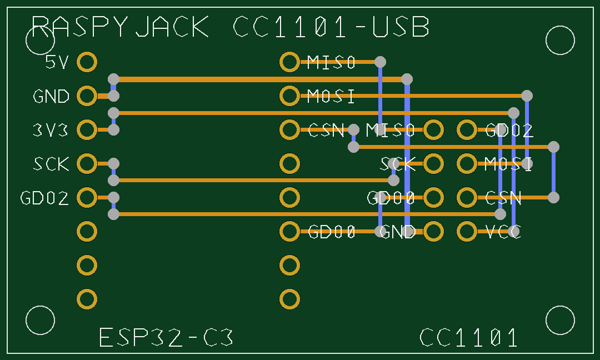

# RaspyJack CC1101-USB — carrier PCB

A 2-layer carrier that turns an **ESP32-C3 SuperMini** + a generic **2×4 CC1101
module** (nRF24L01 footprint, 2.54 mm) into the USB sub-GHz dongle. Upload
`gerbers/` (zipped) to JLCPCB / PCBWay and order. Regenerate everything with
`python3 gen_pcb.py` (runs a geometric DRC, re-emits the Gerbers/drill, and
writes `preview.svg`/`preview.png`).



- **Size:** 44 × 26 mm, 2 layers, 1.6 mm, ~2 €/pc in qty 5.
- **All through-hole**, hand-solderable. No SMD, no RF design (the CC1101
  module carries its own matched antenna).
- Orange = top copper (horizontals), blue = bottom copper (verticals), vias at
  the corners (horizontals-on-top / verticals-on-bottom routing).

## Order settings (JLCPCB defaults are fine)

| Setting | Value |
|---|---|
| Layers | 2 |
| Thickness | 1.6 mm |
| Surface finish | HASL (or ENIG) |
| Copper / silk / mask | as default |
| Drill files | `*-PTH.drl` (plated) + `*-NPTH.drl` (mounting holes) |

The filenames are KiCad-style, so the fab auto-maps the layers. **Always check
the fab's online Gerber preview before paying** — it is the final visual DRC.

## Bill of materials (assembly)

| Qty | Part |
|-----|------|
| 1 | this PCB |
| 1 | ESP32-C3 SuperMini |
| 1 | generic CC1101 module with a **2×4 2.54 mm** header (nRF24L01 footprint) |
| 2 | 1×8 female header strips (2.54 mm) — for the C3 (socketed, removable) |
| 1 | 2×4 female header (2.54 mm) — for the CC1101 |
| 4 | M2 screws/standoffs (optional, 2.2 mm holes) |

Solder the female headers to the PCB and plug the modules in (removable), or
solder the modules directly for the lowest profile.

## Pin order the board expects

**CC1101 — 2×4 header (nRF24L01 footprint), pin 1 = silk tick (bottom-left):**

```
        col. LEFT (toward C3)      col. RIGHT (toward board edge / antenna)
 top     7 MISO                     8 GDO2
         5 SCK                      6 MOSI
         3 GDO0                     4 CSN
 bottom  1 GND   <- pin1            2 VCC (3V3)
```

This is the standard generic "CC1101 nRF24-footprint" module
(`GND,VCC,GDO0,CSN,SCK,MOSI,MISO,GDO2`). A matching 2×4 module plugs straight
in, pin 1 (GND) on the tick. **An E07-M1101D is a 1×8 linear module — it does
NOT fit this 2×4; use a 2×4 module or wire it by signal.**

**ESP32-C3 SuperMini — 2×8, used pins (map: SCK=4, MISO=5, MOSI=6, CS=7,
GDO0=10, GDO2=3):**

```
 left col (x=6)   bottom->top:  NC NC NC  GDO2(G3) SCK(G4) 3V3 GND 5V(NC)
 right col (x=21) bottom->top:  NC NC GDO0(G10) NC NC CSN(G7) MOSI(G6) MISO(G5)
```

Every pad is silk-labelled by signal. ⚠️ **VCC = 3V3, never 5V.**

> After assembly → flash the C3 env and run the self-test: see
> [`../README.md`](../README.md) §3 (`pio run -e esp32-c3 -t upload`) and §5
> (bring-up / `selftest.py`). Fit a **433/868 MHz antenna matched to your
> module before any TX** — never transmit without an antenna (PA damage).

## ⚠️ Before ordering — two sanity checks

1. **C3 row spacing.** The footprint uses the de-facto standard **15.24 mm
   (0.6″)** between the two header rows. Clones vary — measure your SuperMini's
   row-to-row pad spacing, or do a dry fit with headers, before you order a
   batch. (Change `ROW` in `gen_pcb.py` and re-run if yours differs.)
2. **USB-C access.** The C3 mounts with its USB-C on the **top short edge** of
   the board. Rotate the module 180° if you'd rather it face the other way.

## Files

```
gerbers/   raspyjack-cc1101-F_Cu.gbr  B_Cu  F_Mask  B_Mask  F_Silkscreen  Edge_Cuts
           raspyjack-cc1101-PTH.drl   raspyjack-cc1101-NPTH.drl
gen_pcb.py  parametric generator + DRC + preview
preview.svg / preview.png
```
