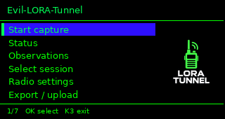

# Evil-LORA-Tunnel

Evil-LORA-Tunnel brings the Pineapple Pager's receive-only LoRa recorder to RaspyJack. On a CardputerZero, the M5Stack Cap LoRa-1262 supplies the SX1262 radio and GNSS receiver. You can also use a USB serial device running LoRaPipe firmware in CLI mode at 115200 baud.

## Record a session

1. With the Zero powered down, fit the cap and attach its antenna. Boot RaspyJack and open **Payload → hardware → Evil-LORA-Tunnel**.
2. In **Radio settings**, choose the region for your location and module (US/Canada, EU868, or Australia/New Zealand). Choose **Meshtastic**, **MeshCore**, or **Both**. The cap is the default receiver. For a separate LoRaPipe receiver choose its USB serial port.
3. Choose **Start capture**. **Status** shows the active profile, GPS state, received and saved packets, queue drops, and storage errors. **Observations** shows recent packets and device summaries. The recorder saves raw bytes even when it cannot decode the payload.
4. Choose **Stop capture** to flush the session. **KEY3** exits the foreground payload. To keep recording while you use RaspyJack, explicitly choose **Record in background** and confirm. Reopen Evil-LORA-Tunnel to see the running recorder and stop it.

Both mode alternates between two region-specific modem configurations every 30 seconds. One SX1262 hears one configuration at a time. Traffic on the other profile is missed until the next dwell. Meshtastic uses LongFast. MeshCore uses a regional narrowband preset. A local mesh using other radio settings may be silent on these presets.

On a serial LoRaPipe, switching or renewing a temporary profile takes about two seconds. The firmware reverts to its saved settings within five minutes of the last change. Its serial interface reports RSSI, SNR and raw bytes; per-packet CRC and preamble are recorded as unknown. The cap driver configures the preamble directly and reads the SX1262's CRC status.

### Radio and GPS setup

The driver uses SPI0 CE1 (`/dev/spidev0.1`), I²C1 address `0x43`, and BCM 26/23/22 for reset, IRQ and BUSY. It enables the cap supply, selects the GPIO mux where available and restores the previous state on close. A mesh client or the optional NFC chip-select overlay can already own these lines. If Status reports a busy GPIO, close the other cap application or check the GPIO22 overlay before retrying. The LCD uses a separate chip select.

The CardputerZero installer supplies the Linux SPI, I²C and GPIO Python bindings. Existing installations can add them with `sudo apt install python3-spidev python3-smbus python3-libgpiod`. The recorder uses pyserial for serial devices and the GNSS UART, and python3-cryptography for decoding public-channel traffic. It uses an existing local gpsd service when available. With the native cap, it can also read NMEA at 115200 baud on an available `/dev/ttyS0`. Recording continues indoors or without a fix. The receiver's position expires after ten seconds without a fresh fix. Advertised node positions are recorded separately.

## Pair a Wi-Fi recording

Choose **Record in background → LoRa + native Wi-Fi**, then run RaspyJack's native **wardriving** payload. This mode releases the cap's GNSS UART so the Wi-Fi recorder can start shared gpsd. Stop and save the Wi-Fi recording before returning to Evil-LORA-Tunnel. Stop the LoRa capture and open **Export / upload** to attach the completed Wi-Fi CSV or PCAP. The file picker browses RaspyJack's loot directory. The recorder copies the chosen file into the LoRa session. Wi-Fi interface selection, supported bands and channel hopping belong to the native Wi-Fi recorder.

## Session files and exports

Each recording gets a directory under `loot/evil-lora-tunnel/`.

| File | Contents |
| --- | --- |
| `session.json`, `status.json` | Capture state, selected profiles, timestamps and counters |
| `observations.jsonl` | Raw bytes, radio settings, RSSI, SNR, CRC status, decoder results and receiver GPS |
| `capture.sqlite3` | Observations and device summaries |
| `lora.pcap` | LoRaTAP frames, link type 270. JSONL and SQLite retain settings such as 62.5 kHz that the LoRaTAP bandwidth field cannot represent |
| `wifi.csv`, `wifi.pcap` | Snapshots of explicitly attached Wi-Fi recordings |
| `.uploads/` | Prepared exports and per-account submission receipts |

Only cleanly closed sessions are eligible for export. **Prepare local export** works offline. The WiGLE and Wardrift exporters use qualifying Wi-Fi rows. The WDGWars exporter prepares separate submissions for Wi-Fi and eligible mesh observations. Accounts and automatic uploads are disabled by default. To upload, enter your own credentials in **Accounts** and enable the destination. Automatic submission requires its own toggle. Settings and credentials live in the owner-only `~/.config/evil-lora-tunnel/config.json`.

For PCAP inspection, TShark 4.6.10 decoded the 35-byte LoRaTAP v1 header and the original payload in a host test. Debian 12's TShark 4.0.17 displayed the final 20 header bytes as packet data. Use a reader with v1 support when comparing exported packet bytes.

## Credits

The recorder, public-channel decoders and export formats are adapted from Valleytech Solutions' MIT-licensed [LORA-Pager-Pipe](https://github.com/hak5/wifipineapplepager-payloads/pull/404). The radio logo uses the same artwork as [LORA Tunnel](https://github.com/valleytechsolutions/LORA-Tunnel). The serial backend implements the receive-log interface from [LoRaPipe](https://github.com/krak3n77/lorapipe). Wiring and GNSS details are available in the [M5Stack cap documentation](https://docs.m5stack.com/en/cap/Cap_LoRa-1262) and the [CardputerZero peripheral guide](https://github.com/CardputerZero/Template/wiki/Peripheral-Development-Guide).
